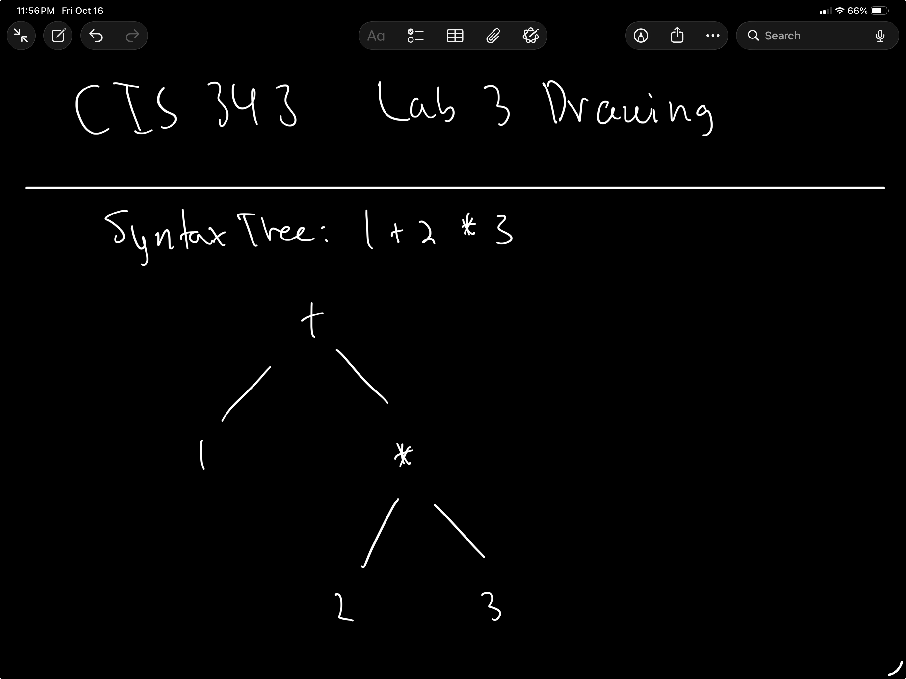

# Lab 3: Parser

## 1. Overview

The goal of this lab was to implement a parser for Nova that converts a sequence of scanned tokens into an abstract syntax tree (AST). The AST is then displayed using the AST printer developed in Lab 2.

The parser uses recursive descent. Each grammar rule is represented by a method, and the parser uses the token types produced by the scanner.

## 2. Grammar

The parser uses the following expression grammar:

```text
expression → or

or → and ( "or" and )*

and → equality ( "and" equality )*

equality → comparison ( ( "!=" | "==" ) comparison )*

comparison → term ( ( ">" | ">=" | "<" | "<=" ) term )*

term → factor ( ( "-" | "+" ) factor )*

factor → unary ( ( "/" | "*" ) unary )*

unary → ( "!" | "-" ) unary
      | primary

primary → "false"
        | "true"
        | "nil"
        | NUMBER
        | STRING
        | "(" expression ")"
```

## 3. Precedence and Associativity

The grammar establishes operator precedence by arranging the rules from lowest to highest precedence. Logical `or` has the lowest precedence, followed by logical `and`, equality, comparison, addition and subtraction, multiplication and division, and unary operators. Literals and grouped expressions are handled by the primary rule.

Binary operators are left-associative because the parser repeatedly consumes operators at the same precedence level and uses the previous expression as the left operand. Unary operators are right-associative because the unary rule recursively parses another unary expression.

For example, `1 - 2 - 3` is parsed as `(- (- 1.0 2.0) 3.0)`. Multiplication takes precedence over addition, so `1 + 2 * 3` is parsed as `(+ 1.0 (* 2.0 3.0))`.

## 4. Design Choices Compared with Lox

The parser follows the recursive-descent approach used by Lox. It uses separate methods for each precedence level and constructs `Binary`, `Unary`, `Grouping`, and `Literal` AST nodes.

The parser reuses the scanner, token class, AST classes, and AST printer from the previous labs. The implementation also supports the `and` and `or` operators recognized by the scanner.

The parser reports syntax errors with the line number and the unexpected token or end of input. It also checks for unexpected trailing tokens so that additional input is not silently ignored.

## 5. Running the Program

From the project directory, run the interactive interpreter with:

```bash
python src/lox.py
```

Enter one expression at the `nova>` prompt. To exit, use Control-D.

To parse an expression stored in a file, run:

```bash
python src/lox.py path/to/expression.lox
```

## 6. Automated Tests

The automated tests were run using:

```bash
python -m unittest discover -s test/lab3 -v
```

The test suite completed with 11 tests passing and no failures.

| Test | Purpose | Result |
|---|---|---|
| `test_operator_precedence` | Checks multiplication before addition | Pass |
| `test_grouping` | Checks grouped expressions | Pass |
| `test_left_associativity` | Checks left-associative subtraction | Pass |
| `test_unary_operators` | Checks unary minus and logical negation | Pass |
| `test_literal_types` | Checks Boolean, nil, string, and number literals | Pass |
| `test_equality_and_comparison` | Checks comparison and equality precedence | Pass |
| `test_logical_operators` | Checks logical `and` and `or` precedence | Pass |
| `test_missing_operand` | Checks an expression with a missing operand | Pass |
| `test_missing_right_parenthesis` | Checks an unmatched opening parenthesis | Pass |
| `test_unexpected_trailing_token` | Checks extra input after an expression | Pass |
| `test_unexpected_operator` | Checks an operator where an expression is expected | Pass |

## 7. Syntax Tree Example

For the expression `1 + 2 * 3`, the parser creates a syntax tree that
shows multiplication has higher precedence than addition.



The root node is `+`. Its left child is `1.0`, and its right child is
the multiplication node `*`, which has `2.0` and `3.0` as its children.

The printed AST is:

`(+ 1.0 (* 2.0 3.0))`

## 8. Error Handling

The parser detects a missing operand, an unmatched opening parenthesis, and unexpected trailing tokens. For example, `1 +` produces an error at the end of the expression, `(1 + 2` reports a missing closing parenthesis, and `1 2` reports the unexpected token after the expression.

The interactive prompt can continue accepting input after an invalid expression. Blank input is ignored.

## 9. Limitations

The parser currently supports expressions rather than complete declarations and statements. Although the scanner recognizes keywords such as `if`, `while`, `var`, and `print`, these are not implemented as parser productions in this lab.

The automated tests cover the expression forms and syntax errors listed above. Additional testing can further verify all operators, file-based execution, and behavior after multiple consecutive errors.

## 10. Conclusion

The Lab 3 parser successfully converts supported Nova expressions into ASTs and prints them using the existing AST printer. All 11 automated tests passed, covering operator precedence, associativity, literals, grouping, logical operators, and representative syntax errors.